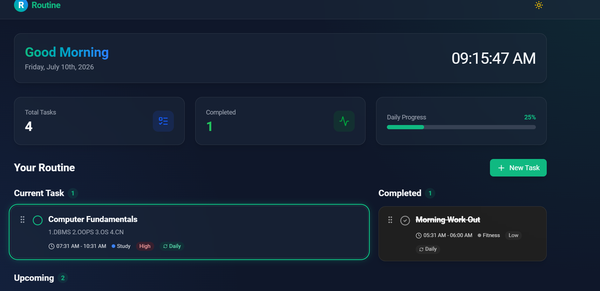
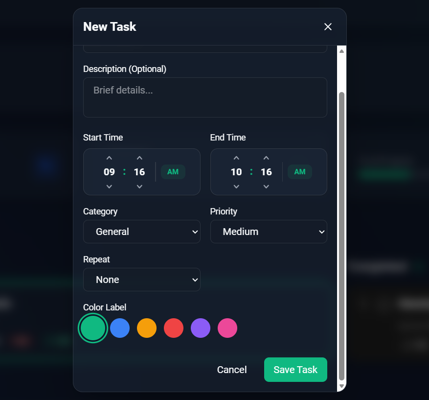

# 🚀 MERN Daily Routine Dashboard

A modern and responsive **Daily Routine Dashboard** built with the **MERN Stack** to help you organize, track, and complete your daily activities efficiently.

Designed with a premium **glassmorphism UI**, the application automatically detects the current task based on your system time, provides live progress tracking, and offers an intuitive drag-and-drop experience for managing routines.

Whether you're planning study sessions, workouts, meetings, or personal goals, this dashboard keeps your schedule organized with real-time updates and a clean user experience.

---

## 📸 Screenshots

### Dashboard



### Add New Task



---

# ✨ Features

### 📅 Smart Routine Management
- Create, edit, delete, and complete tasks
- Automatic current task detection
- Upcoming and completed task sections
- Daily recurring tasks support

### ⏰ Real-Time Updates
- Live digital clock
- Dynamic greeting based on current time
- Automatically updates the active task without refreshing

### 📊 Progress Tracking
- Daily completion percentage
- Visual progress bar
- Task statistics dashboard
- Completed task counter

### 🎨 Premium User Interface
- Glassmorphism-inspired design
- Responsive layout
- Dark/Light mode support
- Smooth animations and transitions

### 🎯 Task Organization
- Categories
- Priority levels
- Custom color labels
- Start & End time scheduling

### 🖱️ Drag & Drop
- Easily reorder tasks
- Powered by **@dnd-kit**
- Smooth drag animations

---

# 🛠 Tech Stack

## Frontend

- React (Vite)
- Tailwind CSS v4
- React Router DOM
- Axios
- Context API
- Lucide React Icons
- React Hot Toast
- @dnd-kit

## Backend

- Node.js
- Express.js
- MongoDB Atlas
- Mongoose
- Express Validator
- Morgan
- Cors
- Dotenv

---

# 📂 Project Structure

```
Routine/
│
├── client/
│   ├── src/
│   ├── public/
│   └── .env
│
├── server/
│   ├── controllers/
│   ├── models/
│   ├── routes/
│   ├── middleware/
│   └── .env
│
└── README.md
```

---

# ⚙️ Installation

## Prerequisites

- Node.js (v18+)
- MongoDB Atlas or Local MongoDB

---

## 1️⃣ Clone the Repository

```bash
git clone https://github.com/yourusername/Routine.git

cd Routine
```

---

## 2️⃣ Backend Setup

Navigate to the server folder.

```bash
cd server
```

Install dependencies.

```bash
npm install
```

Create a `.env` file.

```env
NODE_ENV=development
PORT=5000

MONGODB_URI=your_mongodb_connection_string
```

Start the backend.

```bash
npm run dev
```

Backend runs at

```
http://localhost:5000
```

---

## 3️⃣ Frontend Setup

Open another terminal.

```bash
cd client
```

Install dependencies.

```bash
npm install
```

Create `client/.env`

```env
VITE_API_URL=http://localhost:5000/api
```

Run the frontend.

```bash
npm run dev
```

Open

```
http://localhost:5173
```

---

# 🚀 Deployment

## Frontend (Vercel)

- Push project to GitHub
- Import repository into Vercel
- Root Directory:

```
client
```

Build Command

```
npm run build
```

Output Directory

```
dist
```

Environment Variable

```
VITE_API_URL=https://your-backend-url/api
```

---

## Backend (Render / Railway)

Root Directory

```
server
```

Start Command

```bash
node server.js
```

Environment Variables

```env
NODE_ENV=production
MONGODB_URI=your_mongodb_uri
PORT=5000
```

---

# 💡 Future Improvements

- User Authentication (JWT)
- Multiple Routine Profiles
- Calendar View
- Notifications & Reminders
- Task Search & Filters
- Weekly & Monthly Analytics
- PWA Support
- Mobile App Version

---

# 📄 License

This project is licensed under the **MIT License**.

---

⭐ If you found this project helpful, consider giving it a **Star** on GitHub!
